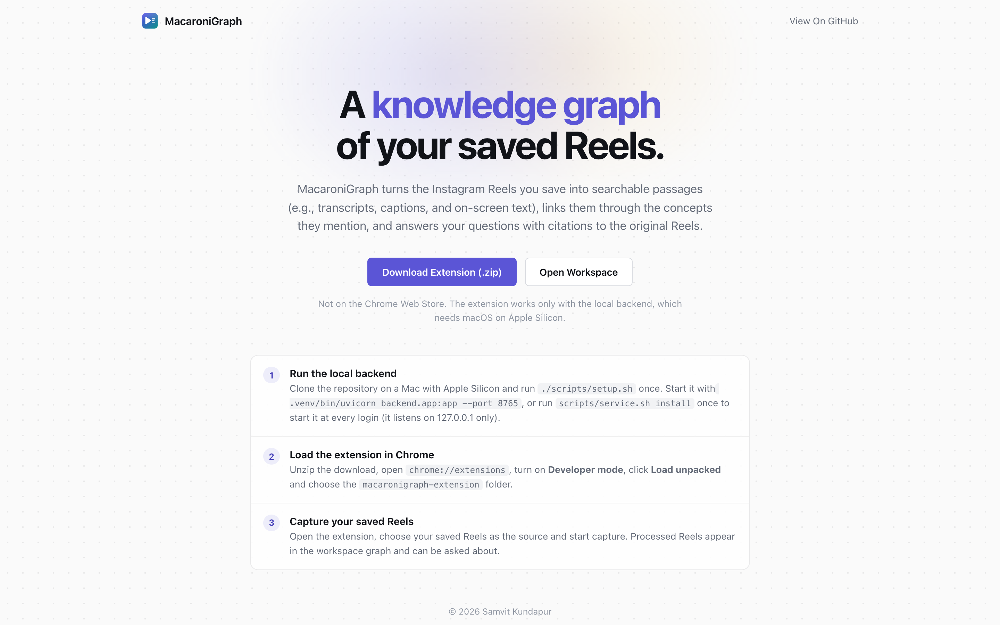
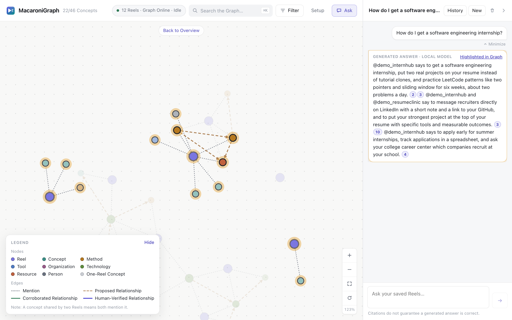

# MacaroniGraph

**A knowledge graph of your saved Instagram Reels.**

[Project page](https://samvit-k.github.io/macaronigraph/) · [Download the extension](https://github.com/samvit-k/macaronigraph/releases/latest/download/macaronigraph-extension.zip)

MacaroniGraph turns the Reels you save into searchable passages (transcripts, captions and on-screen text), links
them through the concepts they mention, and answers your questions with citations to the original Reels.
Transcription, text recognition, embeddings, the graph and the AI answers all run locally on a Mac.





## Architecture

```
Chrome extension (MV3)                    Local backend: FastAPI on 127.0.0.1:8765
 popup → background.js ─ tabCapture ─►    /api/process → spool → background worker
         content.js (worker tab)            ffmpeg → MLX-Whisper → Tesseract → record → SQLite (source of truth)
         offscreen.js (recorder, frames)    indexer  → chunking → Qwen3-Embedding → Chroma      (derived)
                                            graph    → Qwen3-4B extraction → grounding → Neo4j  (derived, optional)
Browser: /workspace/  (React + Cytoscape)   /api/ask → hybrid retrieval → cited answer pipeline
         /welcome     (extension download)  /api/graph/* read-only views · conversations in a separate SQLite file
```

- **Sources of truth:** SQLite holds every Reel and attempt. Chroma and Neo4j are rebuilt from it, and deleting them is
  always safe.
- **Heavy work:** a cross-process lock lets one heavy job run at a time (transcription, embedding, extraction or
  answering). While capture or processing is running, answers are queued and filled in when the model is free.
- **Graceful degradation:** if Neo4j is stopped, retrieval falls back to vector search and says so.

## Privacy and data

- **What runs locally:** all AI inference and knowledge processing — transcription, OCR, embeddings, graph
  extraction and answering. No cloud AI API is called, and the backend listens on `127.0.0.1` only.
- **What uses the network:**
  - capture loads instagram.com in your own logged-in browser;
  - `scripts/setup.sh` downloads ffmpeg, Tesseract and Python packages;
  - `scripts/neo4j.sh install` downloads Neo4j;
  - the first run downloads the Whisper, embedding and language models from Hugging Face;
  - `npm ci` downloads the frontend packages.
- **Where your data lives:** everything MacaroniGraph produces stays in `output/` (records, index, graph,
  conversations), which is git-ignored. So are your Instagram data export and credentials (`.env.local`).
- **Terms of Service:** Instagram's Terms of Use prohibit automated access. MacaroniGraph only visits your own saved
  items, slowly and in your own session, but it is still automated access. Each processed Reel counts as a play.
  Nothing is liked, saved, followed or posted.
- **Extension permissions:** the extension can capture a tab's audio and video, control tabs and run scripts on
  instagram.com, which it needs to play and transcribe Reels. It only talks to instagram.com and the local backend. It
  is not on the Chrome Web Store, so it installs in Developer mode without Google's review and does not auto-update;
  the code and the release zip are public, so you can check what you install.
- **Who can use the backend:** only pages it serves itself and the MacaroniGraph extension, whose ID is fixed by the
  `key` in `extension/manifest.json`. Other websites and other extensions are refused (Origin check), as are requests
  under any host name other than `127.0.0.1`/`localhost`, which blocks DNS rebinding. There is no password, so
  programs running under your own account can still reach it, just as they can read `output/`.

## Requirements

- macOS on Apple Silicon (MLX), with about 10 GB free for models and tools.
- Google Chrome 116 or later.
- [uv](https://docs.astral.sh/uv/), `curl`, and Node.js 20+ with npm (for the workspace).
- Optional, for the knowledge graph: Java 21 or 25. Neo4j Community itself is installed inside the project by `scripts/neo4j.sh`.

## Installation

```bash
git clone https://github.com/samvit-k/macaronigraph.git && cd macaronigraph
./scripts/setup.sh                                    # ffmpeg + Tesseract → .tools/env, Python 3.11 deps → .venv (no sudo)
.venv/bin/python scripts/check_env.py --whisper       # verifies ffmpeg, Tesseract and MLX-Whisper (downloads the model once)
scripts/neo4j.sh install && scripts/neo4j.sh start    # optional knowledge graph (127.0.0.1 only; password → .env.local)
cd frontend && npm ci && npm run build && cd ..       # builds the workspace into backend/static/workspace
```

## Usage

1. **Start the backend:** `.venv/bin/uvicorn backend.app:app --port 8765`.

   Or install it as an optional login service (launchd) that starts it at login and restarts it if it crashes:

   ```bash
   scripts/service.sh install     # stop a backend running in Terminal first; log → output/logs/backend.log
   scripts/service.sh status
   scripts/service.sh uninstall
   ```

   The **Open Workspace** button on the [project page](https://samvit-k.github.io/macaronigraph/) opens
   `http://127.0.0.1:8765/workspace/` on your own Mac, so it works only while the backend is running.
2. **Install the extension:**
   1. Open `http://127.0.0.1:8765/welcome` and click **Download Extension (.zip)**, download it from the
      [latest release](https://github.com/samvit-k/macaronigraph/releases/latest), or use the `extension/` folder directly.
   2. In `chrome://extensions`, turn on **Developer mode**, click **Load unpacked** and choose the folder.
3. **Point it at your saved Reels:**
   1. Request your Instagram data export.
   2. Place the unzipped `instagram-*` folder in the project folder or in `~/Downloads`, or set `SAVED_POSTS_PATH` to
      its `saved_posts.json`. Only `/reel/` links are queued.
4. **Capture:**
   1. Open instagram.com while logged in, as the visible tab of its window.
   2. In the extension popup choose the source and limits, then click **Start Processing**.
   3. Click the **▶ Start Processing** button on the page.

   Each Reel is captured in real time; processing continues in the background.
5. **Explore:** open `http://127.0.0.1:8765/workspace/`.
   - **Overview:** Reels and the concepts several of them share.
   - **Expand:** double-click a node to show everything connected to it.
   - **Inspect:** click a node or edge for source passages and the original Instagram link.
   - **Ask:** use the chat to ask questions. Citations open the exact passage and highlight it in the graph.

Command-line tools:

```bash
.venv/bin/python -m backend.jobs status                   # Reel states, attempts, open sessions
.venv/bin/python -m backend.indexer status|verify         # search index (sync/rebuild only while the backend is stopped)
.venv/bin/python -m backend.graph status|sync|verify      # knowledge graph
.venv/bin/python -m backend.graph review <id> accept|reject [note]
.venv/bin/python scripts/data_digest.py --with-verify --out digest.json     # read-only integrity digest
.venv/bin/python scripts/data_digest.py --compare before.json after.json   # IDENTICAL, or the exact differences
```

### Configuration

Settings come from environment variables; nothing is hardcoded. The main ones:

| Variable | Default | Purpose |
|---|---|---|
| `OUTPUT_DIR` | `output/` | Where records, index, graph data and conversations are stored |
| `SAVED_POSTS_PATH` | auto-detected | Path to the Instagram export's `saved_posts.json` |
| `NEO4J_URI`, `NEO4J_USER`, `NEO4J_PASSWORD` | `bolt://127.0.0.1:7697`, `neo4j`, from `.env.local` | Knowledge graph connection |
| `EMBED_MODEL` | `Qwen/Qwen3-Embedding-0.6B` | Embedding model (pinned revision) |
| `RAG_LLM` / `GRAPH_LLM` | `mlx-community/Qwen3-4B-Instruct-2507-4bit` | Answer and extraction model |
| `ASYNC_PROCESSING`, `INDEX_AUTO`, `GRAPH_AUTO` | `1` | Background processing, automatic indexing, automatic graph sync |
| `ALLOWED_HOSTS` | `127.0.0.1,localhost,::1` | Host names the backend answers to |
| `MACARONIGRAPH_EXTENSION_IDS` | empty | Extra extension IDs allowed, e.g. for your own build without the pinned key |

The answer pipeline's settings are frozen in `fixtures/rag_answer_config.json` (configuration **D6**), and retrieval
parameters in `fixtures/rag_params.json`. Tests check that the code defaults match both files.

## How it works

### Capture and processing

- **Job tracking:** every Reel has a state in SQLite (`pending`, `in_progress`, `queued`, `done`, `needs_retry`,
  `exhausted`, `failed_permanent`, `skipped`).
  - **Leases:** a session leases the Reels it queues. A crashed session's leases are reclaimed after 10 minutes
    without a heartbeat.
  - **Retries:** stops, login walls and lost capture don't count against the 3 retries, and a good result is never
    replaced by a worse one.
  - **Uploads:** repeated uploads are recognised and not processed twice.
- **Background worker:** uploads go to a spool and are processed one at a time, so the next Reel is captured while
  the previous one is processed.
  - **Checkpointing:** the extracted record is checkpointed before the database write, and media is deleted only
    after the attempt is stored.
  - **Failures:** failed jobs are quarantined with their media kept, and crash recovery runs at startup.
  - **Backpressure:** if more than 2 jobs are waiting, uploads wait.
- **Output record:** one canonical record per Reel, its best attempt, holding:
  - metadata with an exact copy of the export entry;
  - capture statistics;
  - the transcript with confidence flags;
  - cleaned OCR segments, with everything raw kept;
  - the passages that feed the search index.
- **OCR clean-up:** nothing is deleted.
  - **Noise:** junk lines are filtered.
  - **Grouping:** lines of one caption are grouped, short-lived subtitle fragments are merged only when they match
    the speech and the layout, and repeats are collapsed.
  - **Speech echo:** on-screen text that repeats the speech is labelled, never removed.

### Search

- **Chunking:** each processed Reel is split into caption, transcript, on-screen and title passages. On-screen text is
  grouped into screens, so lists and code stay intact. Uncertain OCR fragments stay searchable at a lower weight.
- **Model:** `Qwen3-Embedding-0.6B` runs locally on the Apple GPU with a pinned revision.
- **Rebuilds:** changing the model or chunker builds and fully verifies a new collection while the old one keeps
  serving, and switches only on success.
- **Syncing:** automatic syncs run only while capture and processing are idle, and re-embed only changed Reels.

### Knowledge graph

```
(:Reel)-[:HAS_PASSAGE]->(:Passage {chunk_id})-[:MENTIONS {surface, method}]->(:Concept {key})
(:Assertion {predicate, quote, status})-[:SUBJECT|OBJECT]->(:Concept), -[:EVIDENCE]->(:Passage)
```

- **Concepts:** the local model proposes them, and deterministic code verifies them. A concept is kept only if its
  surface form occurs in the evidence passage. Matching is identifier-aware, so CUDA ≠ CUDA-Q, C ≠ C++ and
  x86 ≠ x86-64.
- **Relationships:**
  - The predicate must come from a closed vocabulary, and the quote must be verbatim and name both concepts.
  - They start as `proposed`, become `corroborated` when two or more Reels propose them, and become
    `verified`/`rejected` only by your review.
  - A quote proves provenance, not truth.
- **Co-mention:** two Reels mentioning the same concept is computed at query time and never stored as a relationship.
- **Sync:** each Reel is written in one transaction, extractions are cached in SQLite, and a failed write leaves the
  previous graph untouched.

### Answers

- **Retrieval** (`vector | graph | hybrid`): Chroma passages, plus passages from other Reels that share a specific
  concept or carry relationship evidence.
  - Every graph-found passage must pass a relevance gate, and the channels are fused by weighted rank fusion.
  - Retrieval falls back to vector search when the graph is down.
- **Generation** (configuration D6): at most 6 sentences, each citing numbered sources.
  - **Removed sentences:** those without a valid citation, or with a quote that isn't verbatim in its source.
  - **Absence statements** become a "part not covered" note.
  - **Evidence gate:** abstains only when the evidence is clearly too weak.
- **Exact search:** listing and count questions ("Which Reels mention X?") are answered without the model.
- **Passage selection:** adds answer-bearing passages from Reels already retrieved.
- **Follow-ups:** questions are rewritten from previous questions and cited concepts, never from assistant text.
- **Clarification:** an ambiguous "it" after a question that named several things gets a clarifying question.
- **Claim verification:** implemented but off, because it was measured as not worth its cost with the 4B model.

## API

All routes are served on `127.0.0.1:8765`.

| Route | Purpose |
|---|---|
| `GET /api/health`, `GET /api/status` | Liveness, Reel states, worker backlog |
| `GET /api/session`, `POST /api/session/{id}/heartbeat\|finish`, `GET /api/session/{id}/status` | Capture sessions (used by the extension) |
| `POST /api/process`, `GET /api/results` | Upload a captured Reel; list processed records |
| `GET /api/search?q=&k=&types=`, `GET /api/index/status`, `POST /api/index/sync` | Semantic search and index management |
| `GET /api/graph/status\|verify`, `POST /api/graph/sync`, `GET /api/graph/request/{id}` | Graph status and sync |
| `GET /api/graph/reel/{id}`, `/concept?name=`, `/shared`, `/between?a=&b=`, `/evidence?a=&b=` | Graph queries |
| `GET /api/graph/overview`, `/neighborhood?kind=reel\|concept&id=`, `/search?q=` | Read-only workspace views |
| `POST /api/ask`, `GET /api/ask/{request_id}` | Ask a question (queued answers are polled) |
| `GET\|DELETE /api/conversations`, `GET\|DELETE /api/conversations/{id}` | Conversation history |
| `/workspace/`, `/welcome`, `/welcome/extension.zip` | Workspace, welcome page, extension package |

```bash
curl -X POST 127.0.0.1:8765/api/ask -H 'content-type: application/json' -d '{"question":"Which Reels mention Python?"}'
```

## Testing

```bash
.venv/bin/python -m pytest tests -q          # live Neo4j tests use a throwaway instance (skipped if Neo4j is not installed)
node --test tests/ext/*.test.js              # extension tests
cd frontend && npm test                      # Vitest: graph model, layout, viewport, chat state, inspector
cd frontend && node e2e/workspace.e2e.mjs    # real-browser checks against a running backend with processed Reels
```

- **Isolation:** every Python test runs against a temporary `OUTPUT_DIR`. A session guard refuses to open the
  production database, Chroma directory or Neo4j instance.
- **First run:** some tests use the real Whisper and embedding models, which are downloaded on first use.
- **Browser checks:** these use the installed Google Chrome through `playwright-core`, with no browser download.
  - **Topics:** they come from whatever graph the backend serves.
  - **Your conversations:** the checks touch only conversations they created, identified by ID.

## Evaluation

Measured on the author's saved Reels. All answer judgments are self-assessed by the developer, not independent.

| What | Data | Reproducible from this repository? |
|---|---|---|
| Unit, integration and browser tests | Synthetic fixtures | **Yes** |
| Capture validation on generated test clips (`scripts/make_test_media.py`, `scripts/validate.py`) | Synthetic | **Yes** |
| Search, retrieval and answer results below | The author's saved Reels and question sets built from them | **No.** The datasets contain Reel IDs and quotes and are private |

The evaluation scripts (`scripts/search_eval.py`, `rag_eval.py`, `answer_eval.py`, `ocr_eval.py`) run against your own
collection once you create question sets in the same format. They exit with a message naming the missing files.

| Result | Value |
|---|---|
| Test clips | word error rate ≤ 0.04; every on-screen card shown for at least 1 s recognised |
| Semantic search (34 queries) | Hit@1 0.97, Hit@5 1.00, MRR 0.99 |
| Hybrid retrieval, held-out | Recall@5 **0.977** and evidence coverage **0.984**, vs 0.833 and 0.850 for vector only |
| Answers, sealed held-out set (53 turns) | **75.5% fully correct** (previous configuration: 60.4%); citation validity 100% |
| Answer faithfulness | 7.8% of answer sentences unsupported |
| Listings and follow-ups | 6/8 listings complete; 5/6 follow-ups correct; 2/2 clarifications appropriate |
| Abstention | 7/11 unanswerable questions correctly declined |
| Latency | median warm answer 5.2 s on an Apple Silicon Mac |

- **Sealed set:** it was written and sealed before any answers were generated on it, and was run once per
  configuration.
- **Data safety:** every evaluation ran read-only, and integrity digests of SQLite, Chroma and Neo4j were identical
  before and after.
- **Not shipped:**
  - claim verification by the same 4B model (precision 0.45, recall 0.50, +3 s per answer);
  - a larger 8B answer model, which was no more accurate and was 1.3–2.5× slower.

## Known limitations

- **Answers:**
  - **Correctness:** about 1 in 4 answers is incomplete or wrong, and 7.8% of answer sentences are unsupported.
  - **Abstention:** questions the Reels can't answer, but that are close to their topics, are sometimes answered from
    adjacent or garbled text instead of being declined.
  - **Citations:** a citation shows where a statement comes from; it does not guarantee the statement is correct.
- **Listing and count questions:** phrasings outside the recognised patterns fall back to the model, which can miscount.
  Exact search lists literal mentions only, and transcription misspellings are not aliased.
- **Capture:**
  - Capture runs in real time and needs the worker tab visible and the Mac awake.
  - Reels longer than 180 s are truncated and marked `partial`.
  - Image posts are skipped.
  - Instagram may briefly re-mute playback, which is detected and recorded.
- **Recognition:** OCR misreads stylised or animated text, and Whisper can mishear brand names. On-screen text is
  labelled in answers and the inspector.
- **Relationships:** the graph is mostly Reel–concept mentions. Relationships between concepts are sparse, and stay
  "proposed" until they are corroborated by several Reels or reviewed by you.
- **Platform:** the extension is not on the Chrome Web Store and works only with this local backend, which needs macOS
  on Apple Silicon.

## Project structure

```
backend/      FastAPI app, capture processing (jobs, worker, transcribe, ocr, record), search (chunking, embedder, indexer),
              answers (rag, ask, answer, listing, evidence, verify, conversations), graph/ (extract, normalize, sync, queries, view)
extension/    MV3 Chrome extension: background, content and offscreen scripts, popup (ui/)
frontend/     MacaroniGraph workspace and welcome page (React, Cytoscape, d3-force, Vite) and browser checks (e2e/)
.github/      workflows: publish the welcome page to GitHub Pages; attach the extension zip to tagged releases
scripts/      setup, Neo4j installer, login service, environment check, test-media generator, validation, evaluation and integrity tools
fixtures/     synthetic test media and ground truth, frozen retrieval and answer configurations
tests/        pytest suite (+ tests/ext for the extension)
```

## License

No license has been granted yet. All rights reserved.
